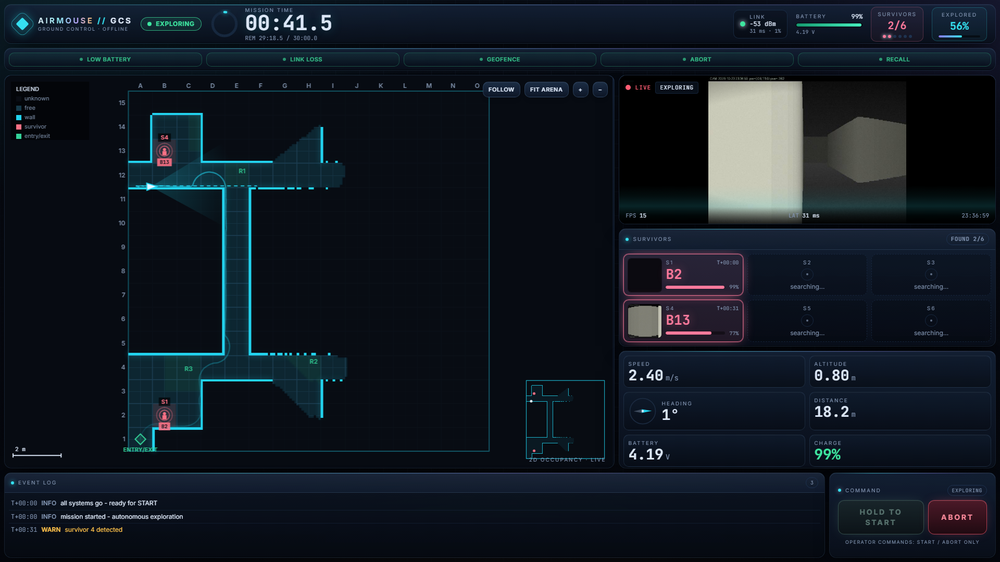
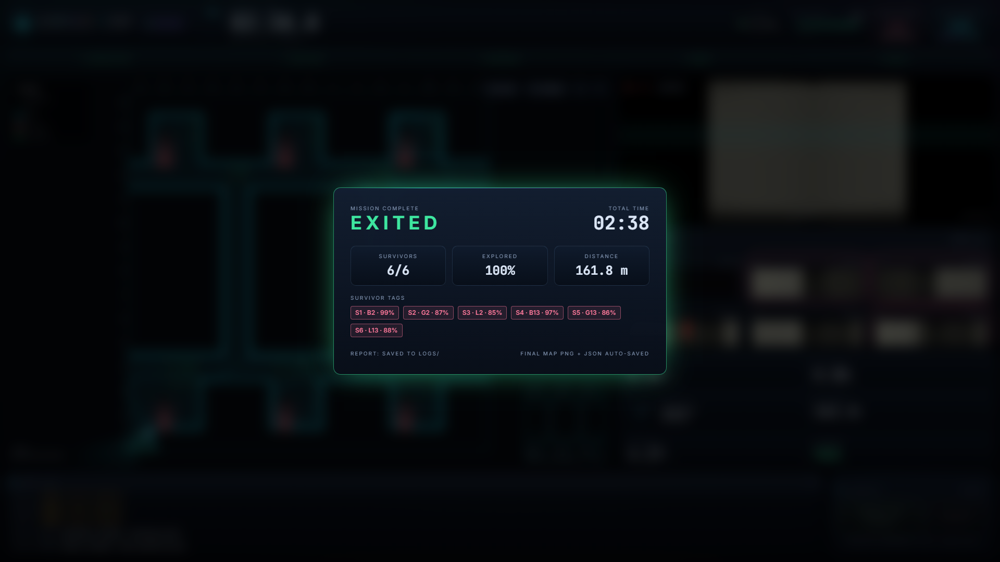

# NIDAR AirMouse — Ground Control Station

Offline ground control station for **AirMouse**, an autonomous GPS-denied indoor
rescue drone (NIDAR Track 1). One laptop, no internet, one operator.

The operator has exactly **two** controls: **START** and **ABORT**. Everything
else — mapping, exploration, survivor detection, return-to-entry — is flown by
the drone and visualised live.





---

## Highlights

- **Live 2D occupancy map** — Canvas 2D only (no WebGL, no map library), rendered
  from the drone's compressed grid stream, with cell labels, trail, plan, FOV,
  minimap and a fit-to-arena view by default.
- **Live camera feed inside the GCS** — MJPEG `` with HUD, scanlines,
  corner brackets, frame-rate/latency readout and click-to-fullscreen.
- **Survivor cards** — up to six slots, each tagged with its computed grid cell
  (e.g. `B2`, `L13`), confidence, detection time and snapshot.
- **Failsafe strip** — LOW BATTERY / LINK LOSS / GEOFENCE / ABORT / RECALL, plus a
  GCS-side stale-telemetry banner.
- **Mission clock** — large timer with a remaining-time ring, survivor pips and an
  explored-percentage bar.
- **Event log** — timestamped info/warn/crit events from the drone.
- **Automatic debrief** — on `EXITED` / `ABORTED` / `FAILSAFE` the final map PNG,
  a JSON report **and a printable PDF** are written to `logs/`, and the debrief
  overlay offers one-click **PDF / JSON / Map PNG** downloads.
- **Recoverable demo runs** — a simulator-only **RESET SIM** control returns
  `ABORTED` / `EXITED` / `FAILSAFE` to `READY` without restarting the server.
- **100% offline** — fonts are bundled via `@fontsource`, textures are inline
  CSS/SVG, no CDN, no tiles, no external APIs. The PDF debrief is rendered
  locally with `reportlab`.

---

## Quick start

Anyone can go from clone to a flying simulation in about five minutes.

### 0. Prerequisites

| Tool | Version | Check with |
| --- | --- | --- |
| Python | 3.11+ | `python --version` (Windows: `py -3 --version`) |
| Node.js | 18+ | `node --version` |
| npm | ships with Node | `npm --version` |

Internet is needed **once**, to download the Python/Node packages. Everything
after that runs fully offline.

### 1. Clone

```bash
git clone https://github.com/tarunt-07/nidar-airmouse-gcs.git
cd nidar-airmouse-gcs
```

### 2. Backend (Python)

Windows (PowerShell / CMD):

```bat
python -m venv .venv
.venv\Scripts\activate
python -m pip install -r requirements.txt
```

macOS / Linux:

```bash
python3 -m venv .venv
source .venv/bin/activate
python -m pip install -r requirements.txt
```

> Skip the virtualenv and `pip install -r requirements.txt` globally if you
> prefer — it works either way. The dependencies are `fastapi`, `uvicorn`,
> `websockets`, `numpy`, `pillow`, `pydantic` and `reportlab`.

### 3. Dashboard (Node)

```bash
cd frontend
npm install          # or: npm ci  (exact lockfile install)
npm run build        # type-checks (tsc) and outputs frontend/dist
cd ..
```

> `frontend/dist` is what FastAPI serves. You only need this build once; rerun
> it after changing frontend code.

### 4. Run it

```bash
# backend + drone simulator (recommended first run)
python run.py --sim --speed 4
```

Then open **<http://127.0.0.1:8000>**.

What you should see:

1. The pre-flight screen with **LINK / VIDEO / MAP / BATTERY** checks turning
   green after ~3 s (the simulator says `READY`).
2. **Press and hold START for 1.5 s** — the drone begins exploring, the map,
   camera, survivor cards and event log update live.
3. When the mission ends (`EXITED`, `ABORTED` or `FAILSAFE`) the debrief
   overlay opens, the report auto-saves to `logs/`, and the **DOWNLOAD
   DEBRIEF** buttons (PDF / JSON / Map PNG) become your copy of the run.

### Launcher options

```text
python run.py                     # backend only (real drone / external ingest)
python run.py --sim               # backend + simulator (1x)
python run.py --sim --speed 4     # faster simulator
python run.py --sim --fail link   # inject a link-loss failsafe
                                  #   choices: link | battery | geofence
python run.py --host 0.0.0.0 --port 8000
```

### Re-running a mission (simulator only)

When a run ends in `ABORTED`, `EXITED` or `FAILSAFE`, the debrief overlay shows
**RESET SIM**. It returns the simulator to `READY`, resets the map, survivors
and event log, and lets you launch again without restarting the server.

The reset is a **simulator-only demo control**:

- it exists only with `python run.py --sim`;
- the backend refuses it unless the ingest client identified itself as the
  simulator;
- it is refused while the drone is airborne (`EXPLORING` / `RETURNING`) — abort
  first;
- real drone hardware still receives only `START` and `ABORT`.

### Frontend development (hot reload)

```bash
# terminal 1
python run.py --sim
# terminal 2
cd frontend
npm run dev        # Vite dev server on :5173, proxies /ws, /ingest and /api to :8000
```

### Verify your install

```bash
curl http://127.0.0.1:8000/api/health
# {"ingest_connected":true,"ingest_is_sim":true,"sim_mode":true,...}
```

`ingest_connected: false` means the simulator/drone is not connected yet —
start with `--sim` if you expected one.

---

## Mission reports & downloads

At the end of every mission the dashboard POSTs the debrief to `POST /api/report`
with **no operator input**. The backend writes three files into `logs/`
(git-ignored, one triplet per run):

| File | Contents |
| --- | --- |
| `mission-report-<ts>.json` | outcome, time, explored %, distance, battery, survivor list with grid cells |
| `mission-report-<ts>.pdf` | printable A4 debrief: stats table, survivor roster, final map |
| `mission-map-<ts>.png` | final occupancy map snapshot |

**From the UI:** the debrief overlay's **DOWNLOAD DEBRIEF** section has three
buttons — `PDF`, `JSON`, `Map PNG`. They work during replay too, and always
fetch the newest saved report.

**From HTTP** (same data, useful for scripts):

| Endpoint | Returns |
| --- | --- |
| `POST /api/report` | dashboard auto-save (report JSON + map PNG data URL) |
| `GET /api/report/pdf` | newest debrief PDF, `Content-Disposition: attachment` |
| `GET /api/report/json` | newest report JSON |
| `GET /api/report/map` | newest map PNG |
| `GET /api/logs` | list of raw mission JSONL recordings |
| `GET /api/logs/<name>` | download one recording (replay input) |

Missing artefacts answer `404 {"detail": "…"}` instead of failing.

---

## Architecture

```text
┌──────────────────────────┐        WebSocket /ingest (JSON)        ┌───────────────────┐
│  drone  /  simulator     │ ────────────────────────────────────▶ │                   │
│  backend/sim/run.py      │ ◀──────────────────────────────────── │  FastAPI backend  │
└──────────────────────────┘        {"cmd":"START"|"ABORT"}        │  backend/app/     │
          │                                                         │                   │
          │ MJPEG  http://localhost:8081/stream                     │  /ws broadcast    │
          ▼                                                         └─────────┬─────────┘
┌──────────────────────────┐                                                  │ WebSocket /ws
│  camera feed ()     │ ◀────────────────────────────────────────────────┘
└──────────────────────────┘                                       ┌──────────▼─────────┐
                                                                   │  React dashboard   │
                                                                   │  Canvas 2D map     │
                                                                   │  START / ABORT     │
                                                                   └────────────────────┘
```

The simulator is just a **drone-side client of `/ingest`**. Replacing it with real
hardware requires zero dashboard changes: the drone connects to `/ingest`, streams
the contract messages and listens for the two commands.

### Layout

```text
run.py                  launcher (backend + optional simulator)
config.json             arena, cell size, timings, video URL
requirements.txt
LICENSE                 proprietary license (all rights reserved)
SECURITY.md             security policy + deployment hardening
backend/
  app/main.py           FastAPI: /ingest, /ws, /api/*, static SPA
  app/report_pdf.py     debrief PDF renderer (reportlab, offline)
  sim/run.py            drone simulator state machine, motion, sensors
  sim/explore.py        frontier exploration on the native 0.1 m grid
  sim/arena.py          arena, walls, survivors, line of sight
  sim/occupancy.py      known-map accumulation and map message
  sim/camera.py         synthetic camera frames (MJPEG)
  sim/config.py         shared simulator constants
frontend/
  src/components/       TopBar, MapPanel, VideoPanel, SurvivorPanel,
                        TelemetryPanel, FailsafeStrip, EventLog, ControlBar,
                        PreflightScreen, MissionEndOverlay, BootSequence
  src/lib/              protocol types, ws client, grid labels, replay, export
  src/store.ts          zustand store
  tailwind.config.js    palette, glows, keyframes
  src/index.css         design system (panels, buttons, textures, animations)
docs/                   preview screenshots
logs/                   mission JSONL + generated reports (git-ignored)
```

---

## Message contract

All messages are JSON over WebSocket. Drone → GCS:

| type | rate | payload |
| --- | --- | --- |
| `telemetry` | 10 Hz | `pose{x,y,yaw}`, `speed`, `alt`, `battery{v,pct}`, `link{rssi,latency_ms,loss_pct}` |
| `mission` | 2 Hz + on change | `state`, `elapsed_s`, `explored_pct`, `survivors_found`, `distance_m` |
| `map` | 2 Hz | `res`, `w`, `h`, `origin{x,y}`, `data` = base64(zlib(int8 row-major)) |
| `path` | 1 Hz | `trail[[x,y]…]`, `plan[[x,y]…]` |
| `survivor` | on detection | `id`, `x`, `y`, `conf`, `t`, optional `snapshot` (base64 JPEG) |
| `failsafe` | 1 Hz + on change | `low_battery`, `link_loss`, `geofence`, `abort`, `recall` |
| `preflight` | on change | `checks{link,video,map_stream,battery,sensors,failsafes}` |
| `event` | on change | `level` (`info`/`warn`/`crit`), `msg` |

Map cells: `-1` unknown, `0` free, `100` occupied.

GCS → drone (the only two commands that exist):

```json
{"cmd": "START"}
{"cmd": "ABORT"}
```

A real drone receives only those two commands. The simulator additionally
accepts a `RESET` control used by the debrief button; the backend sends it only
in `--sim` mode after a simulator `hello` handshake, and never to real hardware.

### Coordinates and cell labels

Arena frame in metres: `(0,0)` is the bottom-left, `+x` right, `+y` up, yaw CCW
from `+x`. The GCS computes the label, not the drone:

```text
column = chr(ord('A') + floor(x / cell_size_m))
row    = floor(y / cell_size_m) + 1
```

so a survivor at `(4.2, 1.3)` with `cell_size_m = 1.0` is `E2`.

---

## Configuration

`config.json` is served to the dashboard at `/api/config`:

```json
{
  "cell_size_m": 1.0,
  "arena_w_m": 15,
  "arena_h_m": 15,
  "entry": { "x": 0.5, "y": 0.5 },
  "max_flight_s": 1800,
  "setup_s": 300,
  "video_url": "http://localhost:8081/stream",
  "map_res_m": 0.1
}
```

- `cell_size_m` — survivor label grid (rooms are 2×2 m, corridors ≥ 1 m).
- `max_flight_s` — mission clock limit (30:00); drives the timer ring and warnings.
- `setup_s` — local pre-flight countdown on the setup screen (no drone command).
- `map_res_m` — occupancy map resolution.

---

## Troubleshooting

| Symptom | Fix |
| --- | --- |
| `'python' is not recognized` / `command not found: python` | Windows: use `py -3`. macOS/Linux: use `python3`. |
| `ModuleNotFoundError: No module named 'fastapi'` | The virtualenv is not active — run `.venv\Scripts\activate` (Windows) or `source .venv/bin/activate`, then reinstall `requirements.txt`. |
| Page says `frontend not built` or is blank | Build the dashboard: `cd frontend && npm install && npm run build`. |
| `Address already in use` on start | Something owns port 8000: `python run.py --port 8001`, or stop the other instance. |
| Event log shows `START ignored: no drone connected` | No simulator/drone on `/ingest` — start with `python run.py --sim`. |
| `RESET SIM` refuses or times out | Run with `--sim`, and abort the mission first (reset is blocked while airborne). |
| Video tile stays black | The MJPEG camera server is at `config.json → video_url` (port 8081). Check no other process holds that port. |
| `npm ci` / `npm install` fails with `ENOSPC` | Your disk is full — free space and retry. |
| Windows Firewall prompt on first run | Allow Python only on a private network; keep `--host 127.0.0.1` unless the drone needs the LAN. |
| Report buttons say `no PDF report saved yet` | Finish a mission first (the debrief saves on `EXITED` / `ABORTED` / `FAILSAFE`), or check `logs/`. |
| Dashboard connects but nothing updates | Check `/api/health` — `last_msg_age_ms` growing means the ingest link stopped. |

---

## Safety / competition rules

- The dashboard can only emit `START` and `ABORT`; no waypoints, no manual flight,
  no map editing.
- START requires a 1.5 s press-and-hold and is enabled only in `READY`.
- ABORT is available while the drone is airborne.
- The debrief **RESET SIM** control is simulator-only and never sent to real
  hardware.
- Everything on screen is produced live from the drone stream; the debrief is
  generated automatically at the end of the mission.

## Security

See [SECURITY.md](SECURITY.md) for the reporting process, the local-only
security model, and the deployment hardening checklist. In short: run offline,
keep the default `127.0.0.1` bind unless the drone needs a LAN, isolate the
drone access point, and never expose `/ingest` or `/ws` to the internet.

## License

**Proprietary — All Rights Reserved.** See [LICENSE](LICENSE).

The GCS is provided for personal, educational, and competition-judging use
only. No commercial use, redistribution, or derivative works without written
permission. It is **not** certified for safety-critical or live rescue flight.
